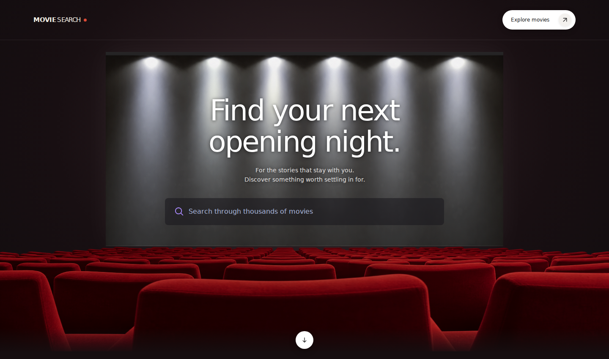

# Movie Search

**Find your next opening night.** A cinema-inspired movie discovery app built with React and Vite, with movie data from TMDB and optional search tracking through Appwrite.

[Explore the live website](https://ria-movie-search.vercel.app/)

## Preview



## Design

The auditorium-inspired hero pairs a softly lit screen with a separate transparent red-seat foreground. The banner copy and search field remain selectable, accessible HTML. A charcoal and burgundy palette continues through the movie collection, with responsive layouts for desktop and mobile.

- Search TMDB movies by title.
- Browse popular movies and see posters, ratings, languages, and release years.
- Use keyboard-accessible search and navigation.
- Track search popularity when Appwrite is configured; tracking errors do not block movie results.
- Handle empty search results and missing movie metadata.

## Run locally

```bash
git clone https://github.com/riiach/Movie-Search-Page.git
cd Movie-Search-Page/my-first-reaact-app
npm install
```

Create `.env.local` in `my-first-reaact-app`:

```env
VITE_TMDB_API_KEY=your_tmdb_read_access_token
# Optional: enable search popularity tracking
VITE_APPWRITE_ENDPOINT=https://your-region.cloud.appwrite.io/v1
VITE_APPWRITE_PROJECT_ID=your_project_id
VITE_APPWRITE_DATABASE_ID=your_database_id
VITE_APPWRITE_TABLE_ID=your_table_id
```

Use a TMDB API read access token (Bearer token). Keep local environment files out of git. Vite variables are included in the browser bundle; never put an Appwrite secret API key in them.

```bash
npm run dev      # Development server
npm run build    # Production build
npm run preview  # Preview production build
npm run lint     # ESLint
```

## Appwrite setup

Optional search tracking uses TablesDB and the browser client. Configure the table permissions for your intended client access and add these columns:

| Column | Type | Purpose |
| --- | --- | --- |
| `searchTerm` | String | Normalized movie search term; use a unique index |
| `count` | Integer | Search count |
| `movie_id` | Integer | First matching TMDB movie ID |
| `poster_url` | String, nullable | Movie poster URL |

## Project structure

The Vite application lives in `my-first-reaact-app/`.

- `src/App.jsx` — cinema hero and movie collection
- `src/index.css` — responsive auditorium design
- `src/components/Search.jsx` — controlled, labelled search field
- `src/components/MovieCard.jsx` — movie poster and metadata
- `src/appwrite.js` — optional search-count integration
- `public/cinema-seats.png` — transparent cinema foreground
- `public/movie-search-preview.png` — browser capture of the current design

## Credits

Created by **Ria Choi**. Originally inspired by the JavaScript Mastery movie app tutorial, with a custom cinema design. Movie data and posters are provided by TMDB. This project is not endorsed or certified by TMDB. Optional search tracking uses Appwrite. The seat foreground was created with AI using the supplied cinema photograph as a reference.
